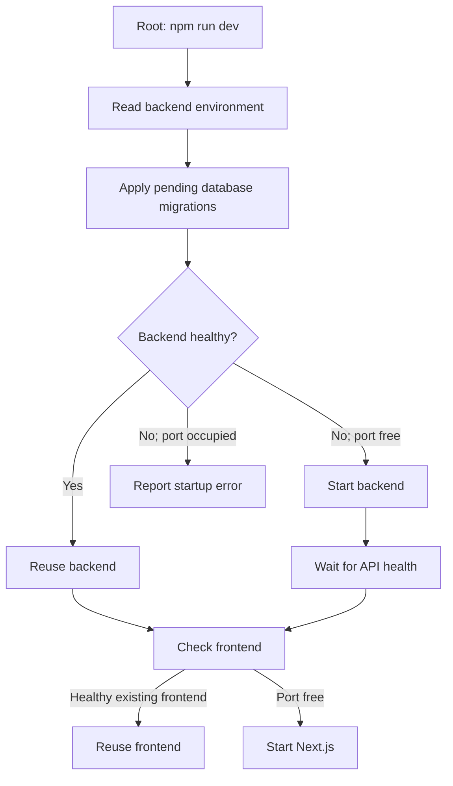
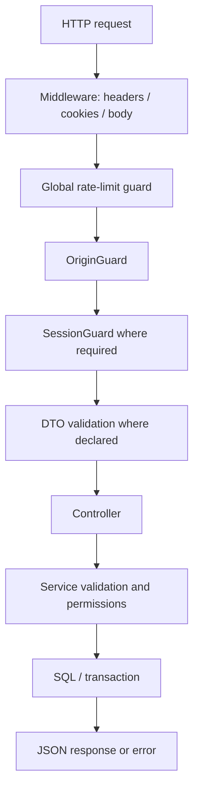
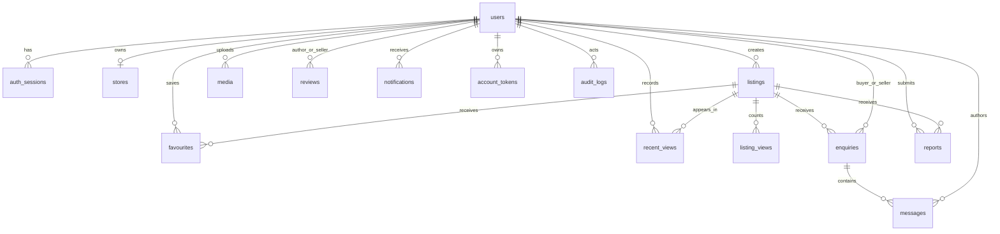
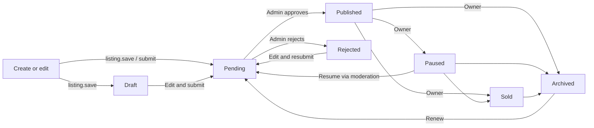
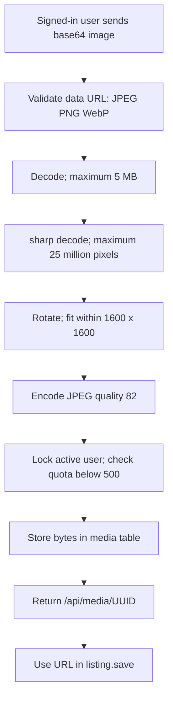
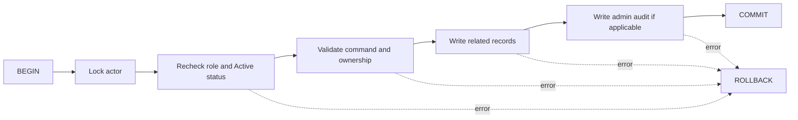

# Garage backend එක වැඩ කරන විදිහ — සම්පූර්ණ සිංහල මාර්ගෝපදේශය

දිනය: 2026-09-12. මෙය repository එකේ implementation එක කියවා සකස් කළ විස්තරයකි. මෙහි test coverage සඳහන් කිරීම, අද tests run කර pass වූ බවට ප්‍රකාශයක් නොවේ.

මෙම app එක vehicle parts marketplace එකක්. Browser එකේ buttons/forms වලින් ලැබෙන requests පරීක්ෂා කරලා, අවසර තිබෙන වෙනස්කම් PostgreSQL database එකේ save කිරීම backend එකේ ප්‍රධාන කාර්යයයි. Accounts, seller stores, listings, photos, enquiries, reviews, moderation සහ emails එයට අයත් වෙනවා.

## මේ document එක කියවන විදිහ

පළමුව architecture diagram එක බලන්න. ඊළඟට login flow සහ listing flow කියවන්න. ඉන්පසු database සහ command reference කොටස් භාවිත කරන්න. Diagrams Mermaid format එකෙන් දී තිබෙන නිසා Mermaid සහාය ඇති Markdown preview එකක visual ලෙස පෙන්වන්න පුළුවන්. එක් එක් diagram එකට පහළින් text explanation එකත් තිබෙනවා.

## 1. සම්පූර්ණ architecture එක

```mermaid
flowchart LR
  U[User / Browser] --> F[Next.js frontend :3000]
  F -->|same-origin /api requests| P[Next.js rewrite]
  P --> N[NestJS backend 127.0.0.1:4000]
  N --> G[Guards and validation]
  G --> C[Controllers]
  C --> S[Services / repositories]
  S --> D[(PostgreSQL)]
  D --> W[Email outbox worker]
  W --> M[SMTP server]
  M --> I[User email inbox]
```



Browser එක සාමාන්‍යයෙන් `http://localhost:3000/api/...` වෙත request එක යවනවා. [next.config.ts](../next.config.ts) හි rewrite එක එය `http://127.0.0.1:4000/api/...` වෙත යොමු කරනවා. ඒ නිසා browser එකට frontend සහ API එක එකම origin එකක් ලෙස පෙනෙනවා.

Backend එක database query කර JSON response එකක් ආපසු දෙනවා. Photo download එකේදී JPEG bytes ලැබෙනවා. Logout success එකේදී body එකක් නැති `204` response එක ලැබෙනවා.

| කොටස | මේ project එකේ භාවිතය |
| --- | --- |
| Next.js / React | UI, forms, navigation, API calls සහ UI state |
| NestJS + Express | HTTP server, controllers, dependency injection, guards |
| TypeScript | Backend සහ frontend code සඳහා types |
| PostgreSQL + `pg` | Accounts, marketplace data, sessions, image bytes සහ queues |
| bcryptjs + Node crypto | Password hashing සහ random tokens |
| sharp | Uploaded images decode කර resize/re-encode කිරීම |
| Nodemailer | SMTP හරහා queued emails යැවීම |
| Nest throttler | Request rate limits; storage එකත් PostgreSQL |

මෙහි Prisma/TypeORM models වෙනුවට `pg` මගින් SQL queries ලියලා තියෙනවා. Database එකට යවන values `$1`, `$2` වැනි parameters ලෙස ලබා දෙනවා.

## 2. Code එකේ වගකීම් බෙදී ඇති විදිහ

| File / folder | වගකීම |
| --- | --- |
| [main.ts](../backend/src/main.ts) | Nest application එක create කර port එකේ listen කිරීම |
| [setup.ts](../backend/src/setup.ts) | `/api` prefix, Helmet, cookies, global validation |
| [app.module.ts](../backend/src/app.module.ts) | Auth සහ Marketplace modules සම්බන්ධ කිරීම; global throttling |
| [environment.ts](../backend/src/config/environment.ts) | Environment variables කියවීම සහ configuration validation |
| [auth.controller.ts](../backend/src/modules/auth/auth.controller.ts) | Login/signup/logout/account routes සහ cookies |
| [auth.service.ts](../backend/src/modules/auth/auth.service.ts) | Password check, account creation, session creation |
| [session.repository.ts](../backend/src/modules/auth/session.repository.ts) | Session token hashes save/find/revoke කිරීම |
| [account.service.ts](../backend/src/modules/auth/account.service.ts) | Password reset, email change, outbox delivery |
| [users.repository.ts](../backend/src/modules/users/users.repository.ts) | User records create/find කිරීම |
| [marketplace.controller.ts](../backend/src/modules/marketplace/marketplace.controller.ts) | State, commands, media, views, contact, health routes |
| [marketplace.service.ts](../backend/src/modules/marketplace/marketplace.service.ts) | Marketplace business rules සහ SQL transactions |
| [validation.ts](../backend/src/modules/marketplace/validation.ts) | UUID, text, email, boolean, choices පරීක්ෂා කිරීම |
| [database.service.ts](../backend/src/database/database.service.ts) | PostgreSQL connection pool සහ startup DB check |
| [migrations](../backend/src/database/migrations) | Database schema එක version අනුව සැකසීම |

**Controller** එක request එක භාරගන්න තැන. **Guard** එක request එක ඉදිරියට යන්න පුළුවන්ද බලන තැන. **Service** එක business rules ක්‍රියාත්මක කරන තැන. **Repository** එක database access සඳහා වෙන් කළ class එකක්. Marketplace service එක තුළ SQL සෘජුවත් ලියලා තියෙනවා; හැම feature එකකටම වෙනම repository එකක් නැහැ.

## 3. `npm run dev` දුන්නම වෙන දේ



[Root dev script](../scripts/dev.mjs) එක frontend සහ backend දෙකම manage කරනවා. Database migrations මුලින් run වෙනවා; API ready වුණාම frontend එක start වෙනවා.

ඔයාට පෙන්නපු `Backend is already running ... No duplicate server was started` message එක [backend dev script](../backend/scripts/dev.cjs) එකේ healthy server check එකෙන් එන එකක්. එය error එකක් නොවෙයි. Port එක occupied වුණත් `/api/health` fail නම් වෙනම error එකක් දෙනවා.

Backend `main.ts` එක JSON body limit එක `8mb` කරනවා, setup apply කරනවා, `127.0.0.1` interface එකේ listen කරනවා. Database service එක startup එකේ `SELECT 1` කරන නිසා database connection එක අත්‍යවශ්‍යයි. Account service එක email worker timer එකත් start කරනවා.

## 4. Request එකක් backend එක ඇතුළේ යන ගමන



මෙය ප්‍රධාන request pipeline එකේ සරල රූපයකි. Route අනුව session guard හෝ DTO validation නොතිබෙන්න පුළුවන්. උදාහරණයක් ලෙස public state endpoint එක session එක optional ලෙස lookup කරනවා; commands endpoint එකට valid session එකක් අනිවාර්යයි.

### Origin සහ CSRF checks

[OriginGuard](../backend/src/common/guards/origin.guard.ts) එක `GET`, `HEAD`, `OPTIONS` සඳහා ඉඩ දෙනවා. Writes සඳහා `X-Garage-Client: web` header එක අවශ්‍යයි. `Origin` header එක තිබුණොත් එය `FRONTEND_ORIGIN` සමඟ හරියටම match විය යුතුයි. CORS enable කරලා නැහැ.

මේ header එක user identity එකක් හෝ password එකක් නොවෙයි. වෙනත් web origin එකකින් browser write requests යැවීම පාලනය කරන protection එකේ කොටසක්. User identity තහවුරු කරන්නේ session එකෙන්.

### Validation

Login/signup DTOs වල email normalize කරනවා, password/name/phone/city lengths check කරනවා. Global ValidationPipe එක DTO properties වලට අමතර injected fields reject කරනවා. උදාහරණයක් ලෙස signup එකෙන් `role: "Admin"` යැවීමෙන් admin වෙන්න බැහැ.

Marketplace commands `unknown` body එක manual validators හරහා check කරනවා. ඒවාට DTO whitelist එක අදාළ වෙනවා කියලා උපකල්පනය කරන්න බැහැ. Service එක භාවිත කරන fields validate කරලා server-owned values තමන්ම තීරණය කරනවා.

## 5. Signup, login සහ sessions

### Signup

`POST /api/auth/signup` body එකේ `name`, `email`, `password`, `phone`, `city` යවනවා. Email trim කර lowercase කරනවා. Password එකේ අවම length 8, උපරිම 128; signup service එක padding spaces ඉවත් කළ පසුවත් අවම length check කරනවා.

Password එක `SHA-256 → base64 → bcrypt cost 12` ලෙස hash කරනවා. මුල් digest එක භාවිත කරන්නේ bcrypt හි 72-byte සීමාව නිසා දිග Unicode passwords වල අවසාන කොටස නොසලකා හැරීම වැළැක්වීමටයි. Plain password database එකේ save කරන්නේ නැහැ.

Transaction එකක user සහ session දෙකම create කරනවා. Default role `Customer`, status `Active`. Duplicate email නම් `409` response එකක් එනවා. Success response එකේ public user object එකත්, browser සඳහා session cookie එකත් ලැබෙනවා.

### Login sequence

```mermaid
sequenceDiagram
  participant B as Browser
  participant F as Next.js proxy
  participant A as Auth controller/service
  participant D as PostgreSQL
  B->>F: POST /api/auth/login {email,password}
  F->>A: Forward request
  A->>D: BEGIN; find user FOR UPDATE
  D-->>A: User and password hash
  A->>A: Compare password; check account status
  A->>D: Insert hashed session token; COMMIT
  A->>D: Revoke previous cookie session if present
  A-->>F: Public user + Set-Cookie
  F-->>B: garage_session cookie
  B->>F: GET /api/state with cookie
  F->>D: Via backend: resolve session and allowed state
  D-->>B: Via backend/proxy: permitted marketplace data
```

User නැති විටත් dummy bcrypt comparison එකක් කරනවා. Wrong password හෝ suspended account සඳහා `Invalid email or password` කියන `401` response එක දෙනවා.

### Cookie එක සහ database session එක

| Browser | Database |
| --- | --- |
| `garage_session` cookie එකේ random token | `auth_sessions.token_hash` හි SHA-256 hash |
| Token එක 32 random bytes වලින් සෑදූ hex characters 64ක් | Token hash, user ID, expiry සහ created time |
| Browser request එකට cookie එක attach කරනවා | Backend token hash කර matching active session හොයනවා |

Cookie flags: `HttpOnly`, `SameSite=Lax`, `Path=/api`; production එකේ `Secure=true`. Default lifetime දින 7යි; `SESSION_DAYS` මගින් 1–30 අතර configure කළ හැකියි. Lookup කරන හැම වතාවකම expiry extend කරන sliding session logic එකක් මෙහි නැහැ.

[SessionGuard](../backend/src/modules/auth/guards/session.guard.ts) token format, session expiry සහ user `Active` status check කර `request.user` පුරවනවා. Valid session එකක් නැත්නම් `401`.

Logout එක current session record එක delete කර cookie clear කරනවා. Password reset/email change සියලු user sessions revoke කරනවා. Login එක අනිත් devices සියල්ල logout කරන එකක් නොවේ; request එකේ පැරණි cookie session එක revoke කරනවා.

**මේ implementation එක JWT auth එකක් නොවේ.** Server-side PostgreSQL session records භාවිත කරනවා.

## 6. Frontend data ලබාගන්නා සහ save කරන ආකාරය

[MarketplaceProvider](../src/providers/marketplace-provider.tsx) මුලින් `GET /api/state` කරනවා. Window focus වුණාම සහ තත්පර 60කට වරක් refresh කරනවා. මෙය WebSocket live stream එකක් නොවෙයි.

State response එකේ `user`, `parts`, `sellers`, `store`, `articles`, `favourites`, `recent`, `enquiries`, `reviews`, `notifications`, `reports`, `users`, `verifications`, `audit`, `contacts`, `references`, `preferences`, `verifiedEmail`, `analytics` ඇතුළත් වෙනවා.

| Viewer | ලැබෙන ප්‍රධාන data |
| --- | --- |
| Guest | Active sellersගේ Published/Sold listings, public stores/reviews, published articles, reference options |
| Signed-in user | Public data සමඟ තමන්ගේ favourites/history/conversations/notifications/preferences/reports |
| Seller / owner | තම listings වල Draft/Pending/other statuses සහ තම store details |
| Admin | සියලු non-deleted listings, user list, verification records, audit, contacts, reports, draft articles |

Admin වුණා කියලා සියලු private enquiry conversations state එකෙන් ලැබෙන්නේ නැහැ. Enquiries query එක buyer හෝ seller ලෙස තමන් සහභාගී වූ conversations පමණක් තෝරනවා.

State read එක `REPEATABLE READ READ ONLY` transaction එකකින් කරනවා. ඒ කියන්නේ response එක assemble කරන අතර queries කිහිපයට එකම database snapshot එක භාවිත කරන එකයි.

### Form update flow

```mermaid
sequenceDiagram
  participant U as UI form
  participant P as MarketplaceProvider
  participant T as commandsForUpdate
  participant A as Backend
  participant D as PostgreSQL
  U->>P: update(state => changedState)
  P->>T: Compare before and after
  T-->>P: Named commands
  loop Each command sequentially
    P->>A: POST /api/commands {action,data}
    A->>D: Validate permissions; transaction
    D-->>A: COMMIT
    A-->>P: {ok:true}
  end
  P->>A: GET /api/state
  A-->>P: Authoritative saved state
  P-->>U: Render updated data
```

[commandsForUpdate](../src/features/marketplace/commands.ts) එක state difference එක explicit actions වලට හරවනවා. Browser එකෙන් මුළු database snapshot එක replace කරන්නේ නැහැ.

උදාහරණයක්:

```json
{
  "action": "favourite.set",
  "data": {
    "id": "11111111-1111-4111-8111-111111111111",
    "saved": true
  }
}
```

මෙහි ID එක example එකක් පමණයි; ඇත්ත request එකට තිබෙන listing ID එකක් අවශ්‍යයි. User ID එක body එකෙන් විශ්වාස කරන්නේ නැහැ; session එකෙන් ගන්නවා.

UI එක concurrent saves lock කරනවා, commands එකින් එක යවනවා, success පසුව state refresh කරනවා. **එක් command එක atomic වුණත් commands කීපයක UI save එකම transaction එකක් නොවේ.** පළමු command එක save වෙලා දෙවැනි එක fail වුණොත් පළමු වෙනස database එකේ ඉතිරි වෙනවා. Error පසුව UI එකේ දර්ශනය stale වෙන්නත් පුළුවන්; නැවත refresh කිරීම වැදගත්.

## 7. Database relationships



Diagram එක සරල කර තිබෙනවා: enquiries සහ reviews වල users වෙත වෙන වෙනම foreign keys දෙකක් තියෙනවා. Listings හි `owner_id` users වෙත සම්බන්ධ වෙනවා; listing create කිරීමේ service rule එකෙන් store එකක් අවශ්‍ය කරනවා.

| Table | Save කරන දේ / විශේෂත්වය |
| --- | --- |
| `users` | Identity, password hash, role, status, preferences JSONB |
| `auth_sessions` | Hashed login tokens සහ expiry |
| `stores` | User එකකට එක් store; unique slug; private reference සහ verification |
| `listings` | Owner, slug, status, moderation, timestamps; part fields `data JSONB` තුළ |
| `media` | Image content `BYTEA` ලෙස database එක තුළ |
| `favourites` | User/listing pair primary key; duplicate saves වැළැක්වීම |
| `recent_views` | User/listing pair සහ last viewed timestamp |
| `listing_views` | Listing/viewer hash/day unique combination |
| `enquiries` | Listing, buyer, seller සහ conversation status |
| `messages` | Conversation messages, author, timestamps |
| `reviews` | Rating 1–5, text, seller reply; buyer/seller pair එකකට එක review |
| `notifications` | Recipient, text, read flag |
| `reports` | Reporter, listing, reason, resolution status/note |
| `articles` | Journal content JSONB, slug, Draft/Published |
| `reference_data` | Categories, Brands, Models, Locations options |
| `contacts` | Public contact form submissions සහ status |
| `audit_logs` | Admin actions; update/delete අවහිර කරන trigger |
| `account_tokens` | Reset token hash සහ expiry; historical verification/email columnsත් ඉතිරිව ඇත |
| `mail_outbox` | Recipient, subject, body, attempts සහ delivery scheduling |
| `rate_limits` | Request counters, expiry, blocked-until |
| `garage_migrations` | Apply කළ migration filenames සහ times |

Listing photos සම්බන්ධ වෙන්නේ `listings.data.images` array එකේ `/api/media/UUID` strings හරහායි. මෙයට වෙනම listing-media foreign-key join table එකක් නැහැ. Ownership validation service එකෙන් කරනවා.

## 8. Seller registration සහ listing lifecycle

### Seller profile

`store.save` එක name, city, description, type සහ business/identity reference validate කරනවා. Store නැත්නම් create කරනවා; තිබුණොත් update කරනවා. `Customer` role එක `Seller` බවට වෙනස් කරනවා. Store name/reference/type වෙනස් කිරීම verification නැවත `Pending` කරයි.

Seller verification එක human admin review එකක්. External identity verification service එකක් මෙහි integrate කරලා නැහැ. `verification.request` නැවත pending review ඉල්ලනවා; admin approve/reject කර note එකක් save කරනවා.

### Listing submit කිරීම

`listing.save` සඳහා තම store එක තිබිය යුතුයි. අලුත් listing එකට client UUID සහ slug යවනවා; backend එක final slug එකට ID prefix එකක් append කරනවා. Existing listing edit කිරීමේදී owner check කරනවා.

Save statuses `Draft` හෝ `Pending` පමණයි. Pending submit කිරීමේදී අවශ්‍ය fields, positive price, valid year range, reference category/brand/location සහ photos check කරනවා. උපරිම photos 10යි; pending සඳහා අවම එකක් අවශ්‍යයි. හැම photo එකම මේ user upload කළ media එකක් විය යුතුයි.



මෙය ප්‍රධාන user journey එකයි; සම්පූර්ණ transition list එක පහළ table එකේ ඇත. Seller `Published` ලෙස resume request කළත් backend එය `Pending` බවට හරවලා moderation වෙත යවනවා. Publish කිරීම admin වගකීමක්.

| Current status | `listing.status` මගින් අවසර ඇති resulting statuses |
| --- | --- |
| Published | Paused, Sold, Archived, Pending |
| Paused | Pending, Archived, Sold |
| Sold | Archived |
| Draft | Archived |
| Pending | Archived |
| Rejected | Archived |
| Archived | Pending |

`listing.save` edit/resubmit path එක මේ status-only table එකෙන් වෙනස්. Ownerගේ non-deleted listing එක නැවත Draft/Pending ලෙස save කළ හැකියි. Admin moderation සඳහා current status Pending හෝ Published විය යුතුයි; result Published හෝ Rejected. Rejection note එක අවම characters 5ක් අවශ්‍යයි.

`listing.delete` physical delete එකක් නොවෙයි: `deleted_at` set කරනවා, featured clear කරනවා, favourites/recent references ඉවත් කරනවා. Historical enquiry/report records තබාගන්නවා.

## 9. Photo upload pipeline



File extension එක විතරක් විශ්වාස කරන්නේ නැහැ. sharp මගින් actual image decode කර format check කරනවා. Small image එකක් enlarge කරන්නේ නැහැ.

`GET /api/media/:id` photo එක ලබා දෙන්නේ owner, admin හෝ active seller කෙනෙකුගේ Published/Sold non-deleted listing එකට අදාළ public photo එකක් නම් පමණයි. Draft photo guest කෙනෙකුට `404` වෙන්න පුළුවන්. Response එක JPEG සහ `private, no-store` cache policy එකෙන් යවනවා.

## 10. Enquiries, reviews සහ notifications

Buyer `enquiry.create` කළාම listing එක Published විය යුතුයි; තමන්ගේ listing එකකට enquiry එකක් create කරන්න බැහැ. Enquiry, පළමු message සහ seller notification එක එක transaction එකේ ලියනවා.

Reply කිරීමට buyer හෝ seller ලෙස conversation participant විය යුතුයි. Closed conversation එකක් නැවත open status එකකට මාරු කරලා reply කළ යුතුයි. Seller reply එකෙන් status `Replied`; buyer reply එකෙන් `New`. `enquiry.status` මගින් participant කෙනෙකුට New/Read/Replied/Closed තෝරාගත හැකියි.

```mermaid
sequenceDiagram
  participant B as Buyer
  participant A as API / Database
  participant S as Seller
  B->>A: enquiry.create
  A->>A: Insert enquiry + message + notifications
  S->>A: GET state
  A-->>S: Own conversation
  S->>A: enquiry.reply
  A->>A: Save reply; notify buyer
  B->>A: review.create
  A->>A: Require approved store and seller reply
  A-->>B: Save one review per buyer/seller
```

Review එකක් සඳහා seller store Approved විය යුතුයි, buyerගේ enquiry එකකට seller reply කර තිබිය යුතුයි, self-review නොවිය යුතුයි. Rating integer 1–5. Database unique constraint එක buyer/seller pair එකකට review එකක් පමණක් ඉඩ දෙයි. Review reply කළ හැක්කේ ඒ sellerටයි.

Notification helper එක `preferences.enquiries=true` නම් in-app notification එක insert කරනවා. `preferences.email=true` නම් වෙනම mail outbox entry එකක් insert කරනවා. මේ preferences දෙක ස්වාධීනයි. `notification.read` recipientගේ records පමණක් update කරනවා.

## 11. Password reset සහ email change

```mermaid
sequenceDiagram
  participant U as User
  participant A as Account service
  participant D as Database
  participant W as Outbox worker / SMTP
  U->>A: forgot-password {email}
  A->>D: Eligible user: hashed token + mail job
  A-->>U: Neutral response
  W->>D: Lock one due unsent job
  W-->>U: Reset email
  U->>A: reset-password {token,password}
  A->>D: Consume valid token; update password
  A->>D: Delete all sessions and account tokens
  A-->>U: Success; sign in again
```

Reset token එකට මිනිත්තු 15ක lifetime එකක් තියෙනවා. Link එක `/auth/reset-password#token=...` ලෙස fragment එකේ token තබනවා. Password reset request response එක account එක තිබුණත් නැතත් එකම neutral message එකයි. මෑතකදී token එකක් හදලා නම් තවත් එකක් වහාම නොහදන check එකත් තියෙනවා.

Token consumption එක database transaction එකේ delete-and-return query එකකින් කරන නිසා successful reset එකකට පසුව token එක නැවත භාවිත කරන්න බැහැ. Password hash update කර sessions සියල්ල revoke කරනවා.

Email change එක `POST /api/auth/change-email` වෙත current password සහ new email යැවීමෙන් කරනවා. Password check කර duplicate email reject කරනවා; email වහාම update කර `email_verified=false` තබනවා, sessions සහ account tokens delete කරනවා. New address confirmation email flow එකක් දැනට නැහැ.

**Email verification flow එක ඉවත් කරලා තියෙනවා.** `email_verified` field එක database එකේ ඉතිරි වුණත් signup/seller onboarding/listing create කිරීමට එය gate එකක් නොවේ. Seller verification සහ listing moderation වෙනම තවමත් ක්‍රියාත්මක වෙනවා. පැරණි docs වල verification instructions තිබුණොත් current controllers/service සහ migration 005 අනුව මේ behavior එක භාවිත කරන්න.

### Email queue ක්‍රියාත්මක වීම

Account service එක තත්පර 10කට වරක් delivery උත්සාහ කරනවා. එක් pass එකකට due unsent job එකක් `FOR UPDATE SKIP LOCKED` මගින් lock කරනවා. SMTP configure නොකළොත් emails queue එකේ රැඳෙනවා.

Success නම් `sent_at` set කර body clear කරනවා. Failure නම් attempts එක වැඩි කර මිනිත්තු 5කට පසු retry schedule කරනවා. Attempts 8ට ළඟා වූ jobs worker එක නැවත select කරන්නේ නැහැ. SMTP යැවීම සහ DB commit එක වෙනම systems නිසා මෙය exactly-once delivery guarantee එකක් නොවේ; email යැවුණු පසු commit fail වුණොත් duplicate delivery විය හැකියි.

## 12. HTTP endpoint reference

සියලු POST requests සඳහා origin/header rules අදාළයි. පහත login අවශ්‍යතාව ඒවාට අමතරයි.

| Method / path | Login | Body / result |
| --- | --- | --- |
| POST `/api/auth/signup` | නැහැ | `{name,email,password,phone,city}` → `{user}` + cookie |
| POST `/api/auth/login` | නැහැ | `{email,password}` → `{user}` + cookie; 200 |
| GET `/api/auth/me` | ඔව් | `{user}` |
| POST `/api/auth/logout` | Valid session අනිවාර්ය නැහැ | Current cookie revoke; 204 |
| POST `/api/auth/forgot-password` | නැහැ | `{email}` → neutral message |
| POST `/api/auth/reset-password` | නැහැ | `{token,password}` → `{ok:true}` |
| POST `/api/auth/change-email` | ඔව් | `{email,password}` → `{ok:true}`; sessions revoked |
| GET `/api/state` | Optional | Role/ownership අනුව state |
| POST `/api/commands` | ඔව් | `{action,data}` → `{ok:true}` |
| POST `/api/contact` | නැහැ | `{name,email,topic,message}` → `{id}` |
| POST `/api/listings/:id/view` | Optional | View/history record → `{ok:true}` |
| POST `/api/media` | ඔව් | `{image:"data:image/png;base64,..."}` → `{url}` |
| GET `/api/media/:id` | Access අනුව | JPEG bytes |
| GET `/api/health` | නැහැ | DB `SELECT 1` success නම් `{status:"ok"}` |

Nest default අනුව explicit override නැති successful POST routes සාමාන්‍යයෙන් `201` return කරනවා; login `200`, logout `204` ලෙස override කරලා තියෙනවා.

## 13. සියලු marketplace commands

මේ actions සියල්ල `POST /api/commands` හරහා යවනවා. Table එකේ fields ප්‍රධාන payload fields; full validation සඳහා service source එක බලන්න.

| Action | Data / වැඩ කරන දේ |
| --- | --- |
| `profile.save` | name, phone, city; email වෙනස් කිරීම separate endpoint එකෙන් |
| `preferences.save` | email/enquiries booleans |
| `store.save` | name, city, description, type, reference; store upsert සහ seller role |
| `verification.request` | Own store නැවත Pending කිරීම |
| `listing.save` | id, slug, title, part fields, price, images, Draft/Pending |
| `listing.status` | id, status; owner සහ transition checks |
| `listing.delete` | id; ownerගේ listing soft-delete |
| `favourite.set` | id, saved boolean |
| `recent.add` | id; own history upsert |
| `recent.clear` | Own history clear |
| `enquiry.create` | id, partId, text; new conversation |
| `enquiry.reply` | id, text; participant-only reply |
| `enquiry.status` | id, status; participant-only state change |
| `review.create` | id, seller slug, rating, text; eligibility checks |
| `review.reply` | id, reply; seller-only |
| `notification.read` | id, read; id=`all` නම් own notifications සියල්ල read |
| `report.create` | id, partId, reason |
| `admin.listing` | id, Published/Rejected status, note |
| `admin.feature` | id, featured boolean; published non-deleted listing |
| `admin.user` | id, Active/Suspended status; admin targets අවහිරයි |
| `admin.verification` | seller user id, Approved/Rejected, note |
| `admin.report` | id, Resolved/Dismissed, note |
| `admin.article.save` | id, slug, title, category, excerpt, body, featured, status |
| `admin.article.delete` | id |
| `admin.references` | kind, items; unique 1–500 options |
| `admin.contact` | id, Open/Resolved status |

සියලු `admin.*` actions server එකේ role check කරනවා. UI එකේ admin button hide කිරීම පමණක් security control එක නොවේ. Admin commands සඳහා audit record එක transaction එක ඇතුළේ create කරනවා.

## 14. Transactions සහ concurrent requests

Command එකකට connection pool එකෙන් connection එකක් අරගෙන `BEGIN` කරනවා. User ID මත advisory transaction lock එකක් ගන්නවා; එකම userගේ commands serialize වෙනවා. User row එක lock කර current role/status නැවත කියවනවා. ඉන්පසු ownership/workflow checks සහ SQL writes කරනවා.



උදාහරණයක් ලෙස enquiry message එක save වුණත් notification insert fail වුණොත් command transaction එක rollback වෙනවා. අර්ධව save වූ conversation එකක් තැබීම වැළැක්වීම එහි අරමුණයි.

PostgreSQL duplicate key error `23505` → `409`; foreign-key error `23503` → `400` ලෙස command service එක map කරනවා. Connection එක අවසානයේ pool එකට release කරනවා.

## 15. Admin, analytics සහ support

Admin account එක signup body එකෙන් create කළ නොහැකියි. Existing active user කෙනෙකු operator command එකෙන් promote කළ යුතුයි:

```sh
# backend folder එකේ; ඇත්ත account email එක යොදන්න
npm run admin:promote -- owner@example.com
```

මේ command එක advisory lock සහ database partial unique index මගින් **එක් Admin account එකක් පමණක්** ඉඩ දෙනවා. Suspended Admin කෙනෙකුත් ඒ limit එකට ඇතුළත්. Promotion එක audit log කර sessions revoke කරනවා; දැනටමත් active Admin කෙනාට නැවත run කිරීම no-op එකක්.

User suspend කිරීමේදී sessions delete කරනවා. Public state query එක suspended sellerගේ listings hide කරනවා. Adminට තමන් හෝ වෙන Admin කෙනෙකු web command එකෙන් suspend කළ නොහැකියි.

Views endpoint එක secret + request IP + UTC date වල SHA-256 hash එක හදනවා. Database unique key එක listing/viewer/day duplicates වැළැක්වීමට භාවිත කරනවා. Login වෙලා නම් recent history එකත් update වෙනවා. Analytics query එක පසුගිය දින 30 aggregate views දෙයි; ownerට තම listings, adminට සියලු listings. මෙය නිවැරදි unique-person count එකක් නොවේ: shared IP එකක users merge වෙන්න පුළුවන්. App UTC date සහ DB CURRENT_DATE timezone එක නොගැළපුණොත් day boundaries වෙනස් වෙන්නත් පුළුවන්.

Contact form එක database `contacts` record එකක් save කරනවා. එම controller එකෙන් support email එකක් සෘජුව යවන්නේ නැහැ. Admin state එකෙන් inbox එක බලලා Open/Resolved ලෙස update කළ හැකියි.

## 16. Configuration සහ run commands

| Variable | අදහස / default |
| --- | --- |
| `PORT` | Backend port; 4000 |
| `FRONTEND_ORIGIN` | Browser origin; `http://localhost:3000`; trailing slash නැතිව |
| `BACKEND_URL` | Next rewrite destination; root/frontend configuration |
| `DB_HOST`, `DB_PORT` | PostgreSQL host සහ port; localhost / 5432 |
| `DB_NAME`, `DB_USER`, `DB_PASSWORD` | Database credentials; password අවශ්‍යයි |
| `DB_SSL`, `DB_SSL_CA` | Database TLS සහ optional CA |
| `SESSION_DAYS` | 1–30; default 7 |
| `SMTP_HOST`, `SMTP_PORT`, `SMTP_SECURE` | Email transport; default port 587 |
| `SMTP_USER`, `SMTP_PASSWORD`, `MAIL_FROM` | SMTP auth සහ sender |
| `VIEW_HASH_SECRET` | View identifier hash සඳහා secret |
| `TRUST_PROXY` | Trusted reverse proxy configuration |
| `NODE_ENV` | Production checks සහ secure-cookie behavior |

Environment source: [backend/.env.example](../backend/.env.example). මේ document එකට actual `.env` secrets copy කරලා නැහැ. Production configuration validation එක HTTPS origin, SMTP host, MAIL_FROM සහ අවම characters 32ක VIEW_HASH_SECRET ඉල්ලනවා. Configuration fields තිබීම email delivery සාර්ථක බවට තහවුරු කිරීමක් නොවේ.

Dependencies install කරලා PostgreSQL සහ backend `.env` configure කර තිබෙන විට root folder එකෙන්:

```sh
npm run dev
```

වෙන වෙනම manage කරනවා නම් root folder එකෙන්:

```sh
npm --prefix backend run db:migrate
npm run dev:api
# වෙනත් terminal එකක:
npm run dev:web
```

Backend commands:

```sh
# backend folder එකේ
npm run build
npm run start
npm run maintenance
```

`build` TypeScript compile කරනවා; `start` `dist/main.js` run කරනවා. Migration script එක source SQL files කියවන වෙනම command එකක්; build කිරීමෙන් migration apply වෙන්නේ නැහැ. Production deployment විස්තර සඳහා [existing production guide](backend-production-guide.md) බලන්න; එහි historical verification කොටස් සඳහා මේ document එකේ current behavior සැලකිල්ලට ගන්න.

## 17. Migrations සහ maintenance

Migration runner එක filenames sort කර, apply නොවූ SQL files පමණක් transaction එකක run කරනවා. Advisory lock එක migrations එකවර run වීම serialize කරනවා. Success filenames `garage_migrations` හි ලියනවා.

| Migration | වෙනස |
| --- | --- |
| 001 | Users සහ sessions |
| 002 | Marketplace tables, roles/preferences, outbox, reference seeds |
| 003 | Shared rate-limit table |
| 004 | Historical email-change token support |
| 005 | Pending verification/email tokens සහ related queued mail retire කිරීම |
| 006 | Single Admin unique index |

Reference options seed කරනවා; default user passwords හෝ sample listings seed කරන්නේ නැහැ. Migration 006 පෙර admins කිහිපයක් තිබුණොත් automatic demotion නොකර migration fail වෙයි.

Maintenance command එක expired rate limits, sessions සහ tokens ඉවත් කරනවා. Sent emails දින 30කට පසුත් unsent emails දින 7කට පසුත් delete කරනවා. දින 7කට වඩා පැරණි, listing කිසිවක image reference එකක් නැති media delete කරනවා. Attempts 8+ failed queued jobs ගණන report කරනවා. Maintenance script එකට scheduler එකක් configure කිරීම වෙනම operational වැඩක්; email worker timer එක මෙය run කරන්නේ නැහැ.

## 18. Errors සහ troubleshooting

| ලක්ෂණය | අර්ථය / බලන්න ඕන තැන |
| --- | --- |
| `401 Please sign in` | Cookie නැහැ, session expired/revoked, හෝ account inactive |
| `403 Request origin is not allowed` | X-Garage-Client header හෝ exact origin mismatch |
| `403 Administrator access required` | Session user Admin නොවේ |
| `404 Photo not found` | Photo නැහැ හෝ viewerට access නැහැ |
| `400 Invalid listing status transition` | Current status එකෙන් target එකට ඒ command මගින් යන්න බැහැ |
| `409 This record already exists` | Unique database constraint conflict |
| `429` | Request rate limit ඉක්මවලා |
| `Backend is already running` | Healthy existing backend reuse කරනවා |
| `relation does not exist` | Database migrations check කරන්න |
| Password reset email එන්නේ නැහැ | SMTP configuration, outbox attempts සහ availability බලන්න |
| UI service unavailable | Backend process, DB, proxy BACKEND_URL සහ health බලන්න |

Default throttle එක route/tracker මට්ටමේ තත්පර 60කට requests 120යි. Login 10, signup 5, forgot-password 3, reset-password 5, change-email 3, contact 5, upload 20 ලෙස overrides තියෙනවා. Counters PostgreSQL එකේ තිබෙනවා; මේවා සියලු routes එකතු කළ එකම global user quota එකක් ලෙස නොගන්න.

Read-only health check:

```sh
curl http://127.0.0.1:4000/api/health
curl http://localhost:3000/api/health
```

Direct backend success වී frontend health fail නම් rewrite/proxy පැත්ත බලන්න. Health success එක DB connectivity තහවුරු කරනවා; SMTP delivery හෝ සියලු business workflows pass බව තහවුරු කරන්නේ නැහැ.

## 19. Tests සහ දැනට තිබෙන සීමාවන්

Repository එකේ test files:

- [auth.test.cjs](../backend/test/auth.test.cjs): DTO normalization/validation, long-password digest differences, origin/header guard checks.
- [auth.e2e.cjs](../backend/test/auth.e2e.cjs): PostgreSQL authentication lifecycle.
- [marketplace.e2e.cjs](../backend/test/marketplace.e2e.cjs): Store/listings, ownership isolation, moderation, media, views, enquiries/reviews, admin rules, reset/email-change flows.

Backend folder එකෙන් `npm test` සහ `npm run test:e2e` run කළ හැකියි. E2E tests PostgreSQL access අවශ්‍ය කරනවා; marketplace suite එක isolated temporary schema එකක් create කර අවසානයේ remove කරනවා. මෙහි documentation ලියන අවස්ථාවේ එම suites නැවත run කරලා නැහැ.

Code එකෙන් දැකිය හැකි practical boundaries:

- Online checkout, payment gateway, shipping හෝ order fulfilment backend එකක් මෙහි නැහැ. Marketplace interaction එක enquiry/reply මත පදනම් වෙනවා.
- Live WebSocket messages නැහැ; frontend polling/focus refresh භාවිත කරනවා.
- State endpoint එක data collections බොහොමයක් එකවර return කරනවා. Listings/users/contacts සඳහා pagination නැති නිසා data ප්‍රමාණය වැඩිවීමේදී payload/query cost වැඩි වෙයි. Recent 20, notifications 200, audit 500 වැනි තෝරාගත් limits තියෙනවා.
- Photos database එකේ තබන නිසා database storage/backups ප්‍රමාණය වැඩි වෙනවා; object storage/CDN integration එකක් දැනට නැහැ.
- Public visibility query එක seller Active status check කළත් shared listing helper එක සියලු command paths සඳහා ඒ check එක නැවත කරන්නේ නැහැ. එබැවින් public UI එකෙන් hide වීම සහ හැම direct command එකකම එකම restriction enforce වීම එකම දෙයක් නොවේ.
- සමහර update commands affected-row count check කරන්නේ නැහැ. උදාහරණයක් ලෙස `admin.feature` matching Published listing එකක් නැති විටත් `{ok:true}` ලබා දෙන්න පුළුවන්.
- Role/ownership checks සහ database locks තිබුණත් මේ document එක සම්පූර්ණ security audit හෝ load-test report එකක් නොවේ.

## 20. Feature එකක් වෙනස් කරන විට follow කරන path එක

උදාහරණයක් ලෙස listing එකට අලුත් field එකක් එකතු කරනවා නම් UI form/type → command translation → `listing.save` validation සහ saved JSON → state response/rendering යන සම්බන්ධතාව බලන්න. JSONB field එකකට හැමවිටම schema migration එකක් අවශ්‍ය නොවුණත් අලුත් relational column/constraint/table එකකට migration එකක් අවශ්‍ය වෙනවා.

අලුත් admin action එකක් නම් controller endpoint එකක්ම අලුතින් හදන්න අවශ්‍ය නොවෙන්න පුළුවන්: existing commands design එකට ගැළපේ නම් named action එකක්, payload validation, server-side admin check, transaction writes සහ relevant tests එකතු කරනවා. Browser state හෝ hidden buttons මත permissions තීරණය නොකරන්න.

මේ project එකේ request එක trace කිරීමට හොඳම starting points තුන: [frontend API helper](../src/lib/api.ts), [marketplace controller](../backend/src/modules/marketplace/marketplace.controller.ts), [marketplace service](../backend/src/modules/marketplace/marketplace.service.ts).
